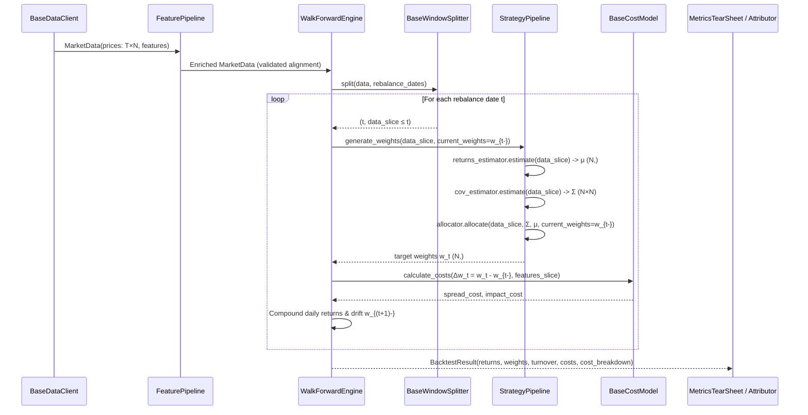
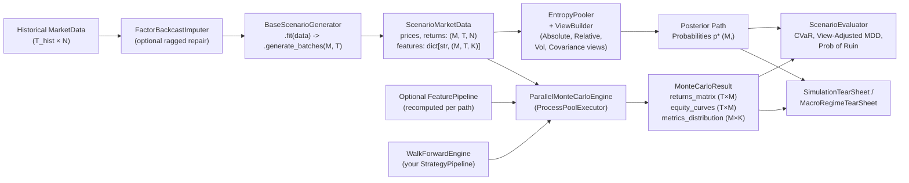
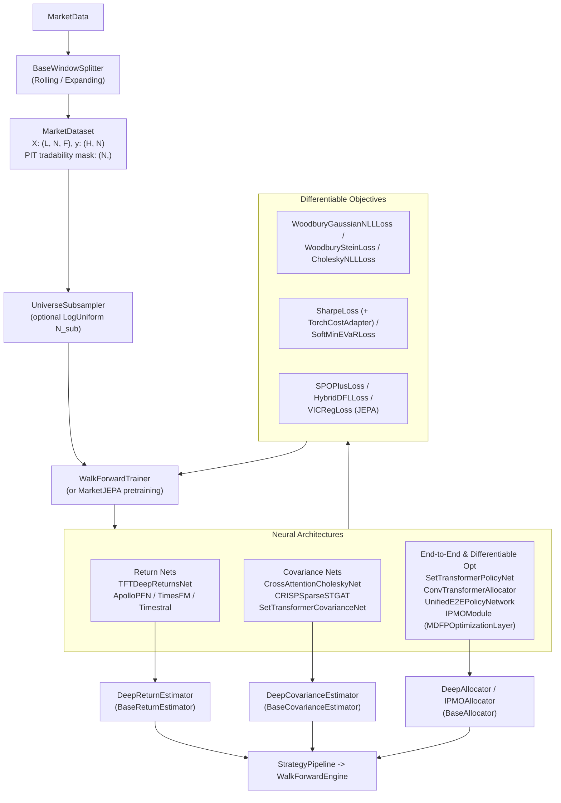
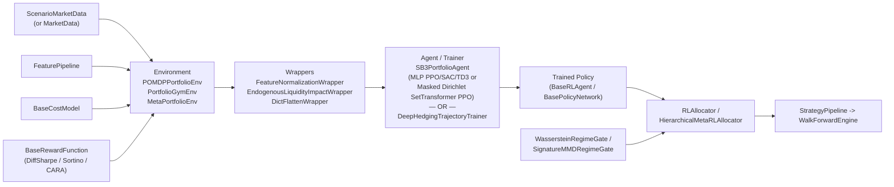
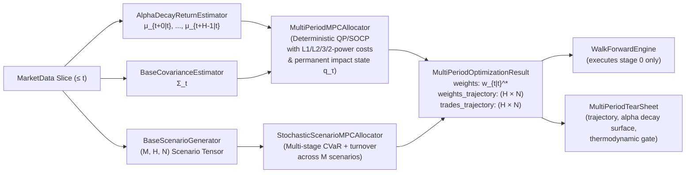

# Data & Execution Flows

PyAlloq supports **five distinct execution paradigms**, all anchored on `MarketData` (2D historical panel) and `ScenarioMarketData` (3D synthetic multiverse tensor). This page traces exact data shapes, control flow, and state handoffs across each paradigm.

---

## 1. Historical Walk-Forward Pipeline

The standard research and production backtest loop enforces strict causal slicing at every rebalance date, tracks intra-period weight drift, and decomposes realized net returns into paper returns, drift/decay, spread, and market impact.

### Key State Handoffs
- **`current_weights` (\(w_{t^-}\))**: At every rebalance date \(t\), `WalkForwardEngine` computes the drifted pre-trade weights \(w_{t^-}\) from the previous holding period and passes them to `StrategyPipeline.generate_weights(data_slice, current_weights=w_prev)`. Turnover-constrained allocators (`MarkowitzAllocator`, `WassersteinDROAllocator`, `MultiPeriodMPCAllocator`, `ConformalSafetyGateAllocator`, `RLAllocator`, `UnifiedE2EPolicyNetwork`) automatically consume `current_weights` to create realistic no-trade zones.
- **`BacktestResult` fields**: Returns `returns` (net), `gross_returns`, `paper_returns`, `weights` (drifted daily), `target_weights` (rebalance targets), `turnover`, `costs`, `cost_breakdown`, and `tear_sheet`.

---

## 2. Multiverse Monte Carlo & Entropy Pooling Flow

Instead of evaluating a strategy on a single historical realization, `pyalloq-simulation` generates \(M\) synthetic trajectories of length \(T\) across \(N\) assets (`ScenarioMarketData`), optionally tilts path probabilities to reflect non-Gaussian macro views via Meucci's `EntropyPooler`, and executes the **exact same** `WalkForwardEngine` across all \(M\) universes in parallel.

### Memory-Bounded Batch Execution
For large simulations (e.g., \(M = 5{,}000\) paths), use `gen.generate_batches(n_paths=5000, horizon=252, batch_size=250)` with `ParallelMonteCarloEngine.run_batches(...)`. Each worker calls `scenario_data.get_path(m, feature_pipeline=...)` to reconstruct a standard `MarketData` slice and run `WalkForwardEngine.run(...)` with zero cross-path memory leakage.

---

## 3. Deep Learning & Differentiable Optimization Flow

Deep learning in `pyalloq.dl` follows a two-phase lifecycle: **causal walk-forward training** (producing weights, covariances, or return forecasts) followed by **drop-in deployment** inside `StrategyPipeline` via `DeepReturnEstimator`, `DeepCovarianceEstimator`, `DeepAllocator`, or `IPMOAllocator`.

### Ragged Universes & Relational Graph Priors
When `allow_ragged=True` is passed to `MarketDataset` and `DeepCovarianceEstimator` / `DeepAllocator`:
1. `MarketDataset.get_tradability_mask(idx)` builds a strictly causal boolean mask \(M_t \in \{0,1\}^N\) for assets with finite prices/returns over `[idx, idx + lookback_window)`.
2. `SetTransformerBackbone` applies pre-projection key/query masking and Scalable-Softmax (SSMax) query scaling \(\frac{s \log(\max(2, N_{\text{active}}))}{\sqrt{d_k}}\) so weights generalize across changing universe sizes.
3. Optional relational priors (`RelationalGraphPriorModule` reading `data.features["relational_graph"]` or `data.cross_sectional["sector"]`) inject additive `attn_bias` matrices into cross-asset attention.
4. `DeepCovarianceEstimator` sets masked assets' off-diagonals to `0` and diagonals to `1e6` so downstream CVXPY optimizers stay strictly SPD and automatically assign zero weight to inactive assets.

---

## 4. Reinforcement Learning & Pathwise Deep Hedging Flow

PyAlloq separates RL into **offline multiverse training** (via Gymnasium environments or differentiable trajectory rollouts) and **online causal deployment** through `RLAllocator` or `HierarchicalMetaRLAllocator`.

### Two Training Paths
1. **Model-Free Actor-Critic (`SB3PortfolioAgent`)**: Interacts with `POMDPPortfolioEnv` (or `MetaPortfolioEnv` for hierarchical blending over \(K\) classical/ML allocators). When `policy_backbone="set_transformer"`, trains `SetTransformerPolicyNet` natively with Masked Dirichlet PPO directly on structured `Dict` observations without flattening.
2. **Pathwise Deep Hedging (`DeepHedgingTrajectoryTrainer`)**: Bypasses high-variance RL policy gradients entirely by unrolling differentiable self-financing wealth and weight-drift dynamics over \(H\)-step batches and backpropagating directly through the entropic certainty-equivalent loss into any `BasePolicyNetwork` (`TrajectoryPolicyNet`, `SetTransformerPolicyNet`, `UnifiedE2EPolicyNetwork`).

---

## 5. Multi-Period & Stochastic MPC Flow

Single-period allocators ignore alpha decay and future transaction costs. Multi-period controllers solve a receding-horizon optimization problem over \(s = 0, \dots, H-1\) and execute only the first-stage decision \(w_t = w_{t|t}^*\).

---

## Next Steps

- See **[Component Composition Recipes](component-composition.md)** for complete, runnable end-to-end wiring examples across all five flows.
- See **[Extending PyAlloq](extending-pyalloq.md)** to build custom estimators, allocators, regime detectors, cost models, or tear sheets.
