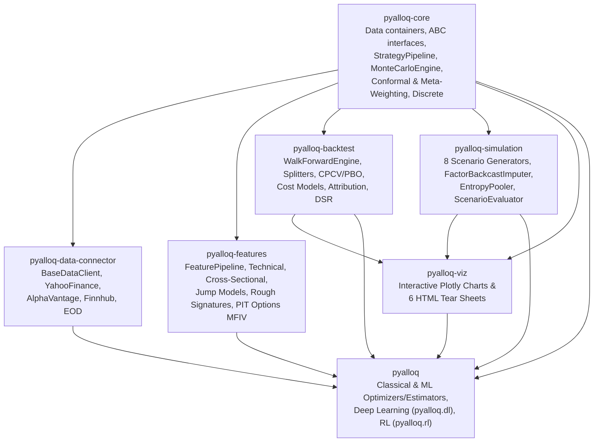
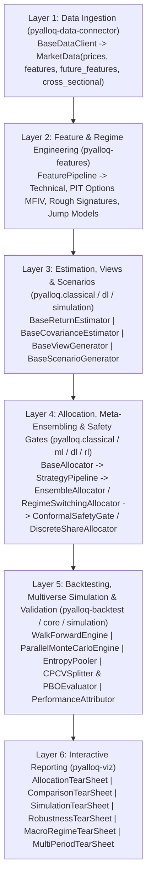

# System Overview & Package Architecture

PyAlloq is structured as a **7-package `uv` workspace** built around strict separation of concerns, point-in-time (PIT) data immutability, and interface-driven composition. Every quantitative workflow — from classical Markowitz optimization to zero-shot foundation models, Differentiable KKT / Deep Learning policies, and Multiverse Reinforcement Learning — plugs into the same core contracts.

---

## Monorepo Package Dependency Graph

The workspace forms a clean Directed Acyclic Graph (DAG) rooted at `pyalloq-core`. No leaf package imports from sibling leaf packages; `pyalloq-viz` aggregates results from `core`, `backtest`, and `simulation`; and the top-level `pyalloq` umbrella package wires all 6 workspace packages together with the classical, ML, DL, and RL model libraries.

### Workspace Package Responsibilities

| Package | PyPI / Workspace Name | Internal Dependencies | Core Responsibility |
|---------|-----------------------|-----------------------|---------------------|
| **Core** | `pyalloq-core` | *None* | `MarketData`, `ScenarioMarketData`, result dataclasses, enums, all `Base*` ABCs, `StrategyPipeline`, `MonteCarloEngine` (`ParallelMonteCarloEngine`), `DiscreteShareAllocator`, `ConformalPIDCalibrator`, `ConformalRiskController`, and online meta-weighting (`pyalloq_core.meta`). |
| **Data Connector** | `pyalloq-data-connector` | `pyalloq-core` | Vendor-agnostic `BaseDataClient` adapters (`YahooFinanceClient`, `AlphaVantageClient`, `FinnhubClient`, `EODClient`) that fetch and normalize OHLCV feeds into `MarketData`. |
| **Features** | `pyalloq-features` | `pyalloq-core` | Leakage-free `FeaturePipeline`, technical & cross-sectional transformers, rolling scalers, `SparseJumpModelDetector` / `ContinuousJumpModelDetector`, `LogSignatureTransformer`, `LiftedHestonRoughVolTransformer`, and `PITOptionsMFIVTransformer`. |
| **Backtest** | `pyalloq-backtest` | `pyalloq-core` | `WalkForwardEngine`, rolling/expanding/purged splitters, `CPCVSplitter` & `PBOEvaluator`, 4 transaction cost models, `PerformanceAttributor`, `MetricsTearSheet` (with DSR/MinTRL/FDR), and `MultiStrategyComparator`. |
| **Simulation** | `pyalloq-simulation` | `pyalloq-core` | 8 stochastic & generative scenario engines producing 3D `(M, T, N)` `ScenarioMarketData`, `FactorBackcastImputer`, Meucci `EntropyPooler` + `ViewBuilder`, and `ScenarioEvaluator`. |
| **Visualization** | `pyalloq-viz` | `pyalloq-core`, `pyalloq-backtest`, `pyalloq-simulation` | Dark/light Plotly themes, specialized plotters (allocation, comparison, contagion, multi-period, regime, robustness, simulation), and 6 `BaseTearSheet` HTML dashboards. |
| **SDK Umbrella** | `pyalloq` | All 6 workspace packages | `pyalloq.classical` (optimizers, return/cov/BL/relevance/Hawkes estimators), `pyalloq.ml` (HRP, Spectral HRP, HERC, NCO, B-HRP), `pyalloq.dl` (SetTransformer, STGAT, IPMO/DFL, JEPA, ApolloPFN/TimesFM/Timestral, Neural SDE), and `pyalloq.rl` (POMDP/Meta envs, SB3 & SetTransformer PPO, Exploratory MV, Deep Hedging, Regime Gates). |

!!! tip "Optional Extras for Deep Learning & RL"
    Core classical, ML, backtest, simulation, and visualization components require only standard scientific Python (`numpy`, `pandas`, `scipy`, `cvxpy`, `scikit-learn`, `plotly`). Heavy deep learning and RL frameworks are isolated behind optional extras: `pyalloq[dl]` (`torch`, `timesfm`), `pyalloq[rl]` (`gymnasium`, `stable-baselines3`), or `pyalloq[all-ml]`. Even without `gymnasium` or `stable-baselines3`, `pyalloq.rl` provides pure-NumPy/PyTorch fallbacks.

---

## Layered Architecture

Every strategy in PyAlloq moves through **six horizontal layers**. Because each layer communicates exclusively through `MarketData`, `ScenarioMarketData`, and typed result objects, you can mix paradigms freely (e.g., feeding `pyalloq-features` rough signatures into a `pyalloq.dl` foundation model view generator, solving with a `pyalloq.classical` Wasserstein DRO allocator, wrapping it in a `ConformalSafetyGateAllocator`, and evaluating it in `WalkForwardEngine` and `ParallelMonteCarloEngine`).

---

## Core Contracts & Base Interfaces

All swappable components inherit from an abstract base class with a single, narrow responsibility:

| Interface | Package | Primary Method Signature | Output Contract |
|-----------|---------|--------------------------|-----------------|
| `BaseDataClient` | `pyalloq_data_connector.base` | `fetch_raw_data(tickers, start_date, end_date)` / `get_market_data(...)` | `MarketData` |
| `BaseFeatureTransformer` | `pyalloq_features.core.base` | `fit(data)` / `transform(data)` | `MarketData` (enriched `features`) |
| `BaseReturnEstimator` | `pyalloq_core.interfaces` | `estimate(data, **kwargs)` | `pd.Series` (annualized expected returns, indexed by asset) |
| `BaseCovarianceEstimator` | `pyalloq_core.interfaces` | `estimate(data, **kwargs)` | `pd.DataFrame` (annualized \(N \times N\) PSD covariance) |
| `BaseViewGenerator` | `pyalloq_core.interfaces` | `generate(data, **kwargs)` | `tuple[pd.DataFrame, pd.Series, pd.DataFrame]` — `(P, Q, Omega)` |
| `BaseRegimeDetector` | `pyalloq_core.interfaces` | `fit(data)` / `detect(data, refit=True)` | `RegimeState` (`probs`, `hard_state`, `confidence`) |
| `BaseAllocator` | `pyalloq_core.interfaces` | `allocate(data, cov_matrix, expected_returns=None, **kwargs)` | `OptimizationResult` (or `MultiPeriodOptimizationResult`) |
| `BaseMetaWeightingStrategy` | `pyalloq_core.meta` | `compute_meta_weights(expert_returns, current_meta_weights=None, **kwargs)` | `np.ndarray` (\(\alpha_t \in \Delta^K\)) |
| `BaseScenarioGenerator` | `pyalloq_core.interfaces` | `fit(data)` / `generate(n_paths, horizon)` | `ScenarioMarketData` (`(M, T, N)` tensors) |
| `BaseScenarioEstimator` | `pyalloq_core.interfaces` | `estimate_scenarios(data, n_paths=250, horizon=20, refit=True)` | `ScenarioMarketData` |
| `BaseWindowSplitter` | `pyalloq_backtest.splitters` | `split(data, rebalance_dates)` | `Generator[tuple[pd.Timestamp, MarketData]]` |
| `BaseCostModel` | `pyalloq_backtest.costs` | `calculate_costs(weights_delta, features_slice=None)` | `float \| pd.Series \| torch.Tensor` |
| `BasePolicyNetwork` | `pyalloq.dl.layers.fragility_kkt` | `forward(x, w_current=None)` / `predict_from_obs(obs)` | `torch.Tensor` (target weights) |
| `BaseRLAgent` | `pyalloq.rl.agents.base` | `fit(total_timesteps)` / `predict(obs, deterministic=True)` | `tuple[np.ndarray, Any]` |
| `BaseRewardFunction` | `pyalloq.rl.rewards.functions` | `compute(net_return, gross_return, turnover, transaction_cost, ...)` | `float` |
| `BaseTearSheet` | `pyalloq_viz.tearsheets.base` | `get_kpis()` / `get_component_figures(theme)` / `to_figure(theme)` | `dict[str, str]`, `list[go.Figure]`, HTML |

---

## Architectural Invariants

Four design invariants hold across the entire SDK:

### 1. Zero-Lookahead Point-in-Time (PIT) Slicing
- `MarketData.validate_alignment()` enforces that every DataFrame in `features` shares the exact `DatetimeIndex` of `prices`.
- `MarketData.slice_time(end_date, lookback=None, horizon_steps=0)` strictly truncates `prices` and `features` at `end_date`. Only explicitly declared **known-future covariates** in `MarketData.future_features` (such as calendar events or scheduled earnings dates) may extend up to `horizon_steps` past `end_date`.
- `MarketDataset(allow_ragged=True)` computes Point-in-Time tradability masks \(M_t \in \{0, 1\}^N\) strictly inside `[idx, idx + lookback_window)` without inspecting the target window `y`, and avoids backward-filling pre-IPO prices.
- `PITOptionsMFIVTransformer` filters option chains strictly on `quote_timestamp <= decision_timestamp`.

### 2. Dual-Role Composability
Several components intentionally implement **two** interfaces so they can slot into multiple parts of a pipeline without adapter boilerplate:
- `ApolloPFNReturnEstimator`, `EnsembleReturnEstimator`, and `NeuralSDEEstimator` inherit from both `BaseReturnEstimator` and `BaseScenarioEstimator` — use them to supply expected returns to Markowitz/DRO, or to generate full 3D `(M, T, N)` scenarios for `StochasticScenarioMPCAllocator` or `ParallelMonteCarloEngine`.
- `ConformalPIDCalibrator` and `AssetSpecificJumpViewGenerator` inherit from both `BaseReturnEstimator` and `BaseViewGenerator` — use them directly as a return estimator or plug them into `BlackLittermanReturnEstimator(view_generator=...)`.
- `SparseJumpModelDetector` and `ContinuousJumpModelDetector` inherit from both `BaseRegimeDetector` and `BaseFeatureTransformer` — run them inside `FeaturePipeline` to attach `regime_probs` / `regime_state` features, or pass them directly into `RegimeSwitchingAllocator`.

### 3. Decorator / Wrapper Allocators
Higher-order allocators implement `BaseAllocator` while wrapping one or more child `BaseAllocator` instances:
- `EnsembleAllocator` blends \(K\) child allocators via online meta-weighting (`pyalloq_core.meta`) with pre-TCA internal trade crossing.
- `RegimeSwitchingAllocator` blends \(K\) regime-specific child allocators using soft regime probabilities from any `BaseRegimeDetector`.
- `ConformalKellyOverlay` and `ConformalSafetyGateAllocator` wrap any base allocator to enforce distribution-free finite-sample tail risk, volatility, turnover, and leverage certificates.
- `HierarchicalMetaRLAllocator` dynamically blends \(K\) child allocators using a trained Meta-RL policy (or switching-cost OLO fallback).

Because every wrapper still returns an `OptimizationResult` through `BaseAllocator.allocate()`, they can be nested arbitrarily (e.g., `ConformalSafetyGateAllocator(base_allocator=EnsembleAllocator([...]))`) and passed directly into `StrategyPipeline`.

### 4. Differentiable & Backtest Cost Parity
`TorchCostAdapter` wraps any `pyalloq_backtest.costs.BaseCostModel` (`FlatBpsCostModel`, `ProportionalSpreadCostModel`, `AlmgrenChrissCostModel`, `CompositeCostModel`) inside PyTorch losses (`SharpeLoss`, `DeepHedgingTrajectoryTrainer`), ensuring that neural policies optimize against the exact same friction model used during out-of-sample evaluation in `WalkForwardEngine`.
