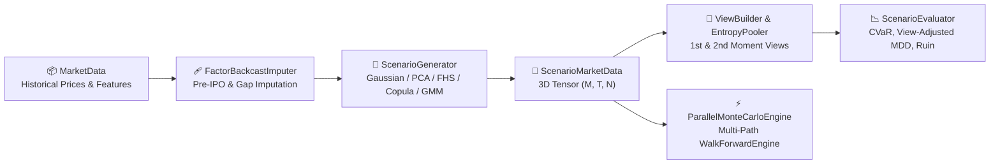

# Monte Carlo Simulation & Entropy Pooling

`pyalloq-simulation` provides a complete synthetic scenario engine for stress-testing portfolio strategies, expressing non-Gaussian market views via **Meucci's Entropy Pooling**, and running parallel multi-path walk-forward backtests across thousands of synthetic market realities.

---

## Architecture Overview



---

## 1. Missing Data Imputation (`FactorBackcastImputer`)

When your portfolio universe includes recent IPOs or assets with interior data gaps, a naive `.dropna()` truncates the entire $N$-asset matrix down to the shortest asset's history.

`FactorBackcastImputer` preserves the full historical length $T$ by extracting principal component factors from anchor assets in return space, regressing partial-history assets onto those factors, injecting matched idiosyncratic volatility, and back-casting continuous price paths.

```python
from pyalloq_simulation import FactorBackcastImputer

imputer = FactorBackcastImputer(
    n_components=3,
    min_coverage=0.85,
    inject_idiosyncratic_noise=True,
)
clean_data = imputer.fit_transform(raw_market_data)
```

!!! tip "Automatic Imputation in Generators"
    Every scenario generator enables `impute_missing=True` by default, automatically applying `FactorBackcastImputer` inside `.fit(data)` whenever missing observations are detected.

---

## 2. Scenario Generators

All generators implement `BaseScenarioGenerator` and output a `ScenarioMarketData` 3D tensor of shape `(M, T, N)` (`n_paths × horizon × n_assets`), along with forward-projected `pd.DatetimeIndex` timestamps and jointly synthesized exogenous `features`.

| Generator | Distribution & Dynamics | Best Used For |
|-----------|-------------------------|---------------|
| `GaussianGenerator` | Multivariate Normal with Ledoit-Wolf shrinkage & Cholesky factorization | Fast baseline testing and isolating optimizer behavior |
| `PCAFactorGenerator` | $K$ latent PCA factors + idiosyncratic Gaussian noise | High-dimensional portfolios ($N \gg K$) |
| `FHSGenerator` | Univariate GARCH(1,1) filtering + synchronous empirical residual bootstrap | Preserving historical volatility clustering and empirical fat tails |
| `GARCHEVTCopulaGenerator` | AR(1)-GARCH(1,1) marginals + Generalized Pareto (EVT) tails + Student-$t$ Copula | Modeling extreme tail risk and simultaneous crash dependence ($\lambda_L > 0$) |
| `GMMRegimeGenerator` | $K$-state Gaussian Mixture Model + Markov transition matrix | Stress-testing structural breaks and Bull/Bear regime shifts |

### Generating Scenarios

```python
import numpy as np
from pyalloq_simulation import (
    GaussianGenerator,
    PCAFactorGenerator,
    FHSGenerator,
    GARCHEVTCopulaGenerator,
    GMMRegimeGenerator,
)

# Example: GARCH-EVT-Student-t Copula Generator
generator = GARCHEVTCopulaGenerator(
    nu=5.0,
    lower_quantile=0.10,
    upper_quantile=0.90,
    dtype=np.float32,
    impute_missing=True,
)
generator.fit(data, log_returns=False)

scenario_data = generator.generate(n_paths=2000, horizon=252)
print(scenario_data.prices.shape)  # (2000, 252, N)
```

### Memory Management & Tensor Batching

A $10,000 \times 252 \times 500$ simulation in `float64` consumes over 20 GB of RAM across price and return tensors. To prevent out-of-memory (OOM) spikes in cloud containers or parallel workers:

1. **Precision Control:** All generators default to `dtype=np.float32` (configurable to `np.float64`).
2. **Streamed Batch Generation:** Use `generate_batches()` to yield memory-bounded `ScenarioMarketData` chunks:

```python
for batch in generator.generate_batches(n_paths=10_000, horizon=252, batch_size=1_000):
    # Each batch holds only (1000, 252, N) in float32
    process_batch(batch)
```

---

## 3. Expressing Market Views & Entropy Pooling

Unlike Black-Litterman—which is restricted to normal distributions and linear return views—**Meucci's Entropy Pooling** blends any non-Gaussian Monte Carlo prior with first-moment (return) and second-moment (volatility and correlation/covariance) views by minimizing the Kullback-Leibler divergence between prior probabilities $p$ and posterior probabilities $x^*$.

### Supported View Types

| View Class | Moment | Example |
|------------|--------|---------|
| `AbsoluteView` | 1st (Return) | `"AAPL cumulative return >= 5%"` |
| `RelativeView` | 1st (Spread) | `"MSFT outperforms GOOGL by >= 2%"` |
| `VolatilityView` | 2nd (Volatility) | `"AAPL volatility increases by 50% (multiplier=1.5)"` |
| `CovarianceView` | 2nd (Correlation / Covariance) | `"AAPL–MSFT correlation >= 0.60"` |

```python
from pyalloq_simulation import (
    AbsoluteView,
    RelativeView,
    VolatilityView,
    CovarianceView,
    ViewBuilder,
    EntropyPooler,
)

views = [
    AbsoluteView(asset="AAPL", operator="==", target=0.08),
    RelativeView(asset_outperformer="MSFT", asset_underperformer="AMZN", operator=">=", target=0.02),
    VolatilityView(asset="AAPL", operator=">=", multiplier=1.50),
    CovarianceView(asset_1="AAPL", asset_2="MSFT", operator=">=", target_correlation=0.50),
]

builder = ViewBuilder(scenario_data)
A_ineq, b_ineq, C_eq, d_eq = builder.build(views)

pooler = EntropyPooler(n_scenarios=scenario_data.n_paths)
entropy_result = pooler.fit(A_ineq=A_ineq, b_ineq=b_ineq, C_eq=C_eq, d_eq=d_eq)

print(f"Converged: {entropy_result.success}, KL Divergence: {entropy_result.kl_divergence:.4f}")
```

---

## 4. Path-Dependent Risk Evaluation (`ScenarioEvaluator`)

Terminal metrics alone miss intra-horizon crashes that trigger margin calls or risk limits. `ScenarioEvaluator` evaluates both terminal and intra-horizon path metrics across all $t \in [0, T]$ weighted by the posterior scenario probabilities `entropy_result.weights`:

- `expected_return`: Posterior probability-weighted cumulative return.
- `volatility`: Posterior probability-weighted return standard deviation.
- `sharpe_ratio`: View-adjusted horizon Sharpe ratio.
- `cvar_95`: Posterior probability-weighted 95% Conditional Value-at-Risk (Expected Shortfall).
- `view_adjusted_mdd`: Posterior probability-weighted Maximum Drawdown across the $(M, T+1)$ wealth trajectory.
- `probability_of_ruin`: Posterior probability mass of paths whose intra-horizon drawdown or equity drop breaches `ruin_threshold` (default `-0.30`, i.e., a 30% loss).

```python
import numpy as np
from pyalloq_simulation import ScenarioEvaluator

evaluator = ScenarioEvaluator(risk_free_rate=0.03, ruin_threshold=-0.30)
weights = np.array([0.25, 0.25, 0.25, 0.25])

metrics = evaluator.evaluate(
    scenario_data=scenario_data,
    asset_weights=weights,
    entropy_result=entropy_result,
)

print(f"Expected Return:     {metrics.expected_return:.2%}")
print(f"CVaR (95%):          {metrics.cvar_95:.2%}")
print(f"View-Adjusted MDD:   {metrics.view_adjusted_mdd:.2%}")
print(f"Probability of Ruin: {metrics.probability_of_ruin:.2%}")
```

---

## 5. Multi-Path Strategy Backtesting (`ParallelMonteCarloEngine`)

To evaluate how a full `StrategyPipeline` and `WalkForwardEngine` perform across hundreds or thousands of synthetic market paths, use `ParallelMonteCarloEngine` (also aliased as `MonteCarloEngine` in `pyalloq_core.engines`).

### Hybrid Feature Synthesis for Deep Learning & Technical Indicators

1. **Exogenous Features (`data.features`):** Automatically projected inside every `BaseScenarioGenerator` conditioned on simulated asset returns so Deep Learning estimators (such as `DeepCovarianceEstimator`) receive aligned 3D feature tensors.
2. **Endogenous Technical Features (`FeaturePipeline`):** Pass a `FeaturePipeline` to `ParallelMonteCarloEngine(feature_pipeline=...)` to deterministically recompute price-derived indicators (e.g., RSI, MACD, rolling volatility) on each synthetic path inside the worker pool.

```python
from pyalloq_core.engines import ParallelMonteCarloEngine
from pyalloq_core.pipeline import StrategyPipeline
from pyalloq_backtest.engine import WalkForwardEngine
from pyalloq_backtest.splitters import RollingWindowSplitter
from pyalloq.classical.optimizers.risk_parity import RiskParityAllocator
from pyalloq_features.core.pipeline import FeaturePipeline
from pyalloq_simulation import GaussianGenerator

# 1. Fit generator on historical MarketData
gen = GaussianGenerator()
gen.fit(data)

# 2. Configure standard WalkForwardEngine
pipeline = StrategyPipeline(allocator=RiskParityAllocator(tickers=data.assets))
wf_engine = WalkForwardEngine(
    pipeline=pipeline,
    splitter=RollingWindowSplitter(lookback_window=60),
    rebalance_freq="ME",
)

# 3. Execute across streamed scenario batches in parallel
mc_engine = ParallelMonteCarloEngine(
    backtest_engine=wf_engine,
    max_workers=4,
    feature_pipeline=FeaturePipeline(),  # optional per-path feature transformers
)

batches = gen.generate_batches(n_paths=100, horizon=252, batch_size=25)
mc_result = mc_engine.run_batches(batches)

print(mc_result.equity_curves.shape)          # (T, 100)
print(mc_result.metrics_distribution.head())  # Distribution of Sharpe, MDD, Sortino across paths
```
