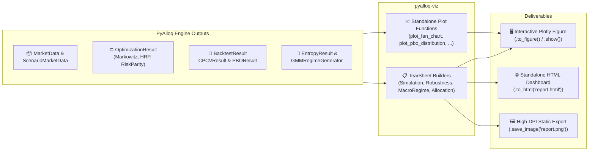

# Visualization & Tear Sheets (`pyalloq-viz`)

`pyalloq-viz` provides an institutional visualization suite for `pyalloq`. It turns your optimization results, walk-forward backtests, Monte Carlo scenarios, and macroeconomic views into interactive Plotly figures and standalone HTML tear sheet dashboards.

---

## Architecture & Workflow



### Two Ways to Visualize

1. **Granular Plot Functions (`plot_*`)**: Every visualization is exposed as a standalone function returning a styled `plotly.graph_objects.Figure`.
2. **Composite Tear Sheet Classes (`*TearSheet`)**: Four specialized tear sheet classes group related charts and compute summary KPIs:
   - `SimulationTearSheet`: Synthetic path cones, terminal wealth & ruin, CVaR tail shading, and drawdown cones.
   - `RobustnessTearSheet`: Probability of Backtest Overfitting (PBO) and Combinatorial Purged Cross-Validation (CPCV) timeline scrambling.
   - `MacroRegimeTearSheet`: Meucci Entropy Pooling prior-vs-posterior shifts and GMM Markov regime transition overlays.
   - `AllocationTearSheet`: Multi-universe efficient frontier, weight drift & turnover, hierarchical treemaps, component risk contributions, and correlation/monthly return heatmaps.

---

## 1. The Multiverse & Simulation Tear Sheet

Evaluates synthetic futures (`ScenarioMarketData` or `MonteCarloResult`), supporting both uniform scenario weights and view-adjusted posterior probabilities (`EntropyResult`).

| Function / Class | What It Visualizes | Key Inputs |
|------------------|--------------------|------------|
| `plot_fan_chart` | Median & expected equity trajectories enveloped by probability-weighted percentile bands (`5–95`, `10–90`, `25–75`) + spaghetti paths | `ScenarioMarketData` or `MonteCarloResult`, optional `EntropyResult`, optional `benchmark` |
| `plot_terminal_wealth_ruin` | Terminal wealth density & histogram with shaded left-tail ruin region below `1 + ruin_threshold` | `ScenarioMarketData` or `MonteCarloResult`, `ruin_threshold` (e.g. `-0.20`) |
| `plot_cvar_tail_risk` | Return distribution with vertical markers at \(\text{VaR}_\alpha\) and \(\text{CVaR}_\alpha\) (Expected Shortfall) and shaded tail shortfall mass | `ScenarioMarketData`, `MonteCarloResult`, or `BacktestResult`, `alpha=0.05` |
| `plot_drawdown_fan_chart` | Underwater drawdown probability bands across all \(M\) synthetic trajectories | `ScenarioMarketData` or `MonteCarloResult`, optional `EntropyResult` |
| `SimulationTearSheet` | Combines all 4 charts into a `2×2` figure or HTML dashboard with 7 summary KPIs | All of the above |

=== "TearSheet Dashboard"

    ```python
    from pyalloq_simulation import GMMRegimeGenerator, ViewBuilder, AbsoluteView, EntropyPooler
    from pyalloq_viz import SimulationTearSheet

    # 1. Generate 500 synthetic paths over 63 trading days
    gen = GMMRegimeGenerator(n_regimes=2, random_state=42)
    gen.fit(market_data)
    scenarios = gen.generate(n_paths=500, horizon=63)

    # 2. Optional: Apply Entropy Pooling views
    builder = ViewBuilder(scenarios)
    A, b, C, d = builder.build([AbsoluteView(asset="AAPL", operator=">=", target=0.02)])
    entropy_res = EntropyPooler(n_scenarios=scenarios.n_paths).fit(A_ineq=A, b_ineq=b, C_eq=C, d_eq=d)

    # 3. Build & export the Simulation Tear Sheet
    sim_ts = SimulationTearSheet(
        scenarios,
        asset_weights=backtest_result.weights.iloc[-1],
        entropy_result=entropy_res,
        ruin_threshold=-0.15,
        cvar_alpha=0.05,
        benchmark=backtest_result,
    )

    sim_ts.show()                              # Render 2x2 Plotly figure
    sim_ts.to_html("simulation_report.html")   # Save standalone HTML dashboard
    ```

=== "Individual Plot Functions"

    ```python
    from pyalloq_viz import (
        plot_fan_chart,
        plot_terminal_wealth_ruin,
        plot_cvar_tail_risk,
        plot_drawdown_fan_chart,
    )

    fig_fan  = plot_fan_chart(scenarios, entropy_result=entropy_res, benchmark=backtest_result)
    fig_ruin = plot_terminal_wealth_ruin(scenarios, entropy_result=entropy_res, ruin_threshold=-0.15)
    fig_cvar = plot_cvar_tail_risk(scenarios, entropy_result=entropy_res, alpha=0.05)
    fig_dd   = plot_drawdown_fan_chart(scenarios, entropy_result=entropy_res)
    ```

---

## 2. Robustness & Overfitting Tear Sheet

Proves whether a strategy's historical performance is genuinely robust or an artifact of backtest overfitting and chronological luck, powered by `PBOEvaluator` and `CPCVSplitter` in `pyalloq_backtest`.

| Function / Class | What It Visualizes | Key Inputs |
|------------------|--------------------|------------|
| `plot_pbo_distribution` | **CSCV Mode**: Rank logit (\(\lambda_c\)) KDE with shaded overfitting mass (\(\lambda_c \le 0\)) + In-Sample vs. Out-of-Sample Sharpe degradation regression.<br>**Benchmark Mode**: Simulated/CPCV Sharpe distribution vs. historical backtest Sharpe + survival ECDF. | `PBOResult`, `(T, M)` trial matrix, or `BacktestResult` + `CPCVResult`/`MonteCarloResult` |
| `plot_cpcv_paths` | Recombined combinatorial timelines scrambling the chronological order of market regimes + path-level Sharpe vs. Max Drawdown scatter | `CPCVResult` or `BacktestResult` |
| `RobustnessTearSheet` | Unified `2×2` overfitting & regime-scrambling dashboard with PBO, OOS loss probability, and CPCV survival KPIs | `BacktestResult`, `PBOResult`, or `(T, M)` trial matrix |

=== "Single-Strategy CPCV & Benchmark Mode"

    ```python
    from pyalloq_backtest import CPCVSplitter
    from pyalloq_viz import RobustnessTearSheet, plot_cpcv_paths, plot_pbo_distribution

    # Scramble historical strategy returns across 6 chronological regime blocks
    splitter = CPCVSplitter(n_groups=6, k_test_groups=2, max_paths=100)
    cpcv_result = splitter.scramble_timelines(backtest_result)

    # Individual plots:
    fig_cpcv = plot_cpcv_paths(cpcv_result)
    fig_pbo  = plot_pbo_distribution(backtest_result, synthetic_comparison=cpcv_result)

    # Full Tear Sheet:
    rob_ts = RobustnessTearSheet(backtest_result, cpcv_or_synthetic=cpcv_result)
    rob_ts.to_html("robustness_report.html")
    ```

=== "Multi-Strategy CSCV Matrix Mode"

    ```python
    from pyalloq_backtest import PBOEvaluator
    from pyalloq_viz import RobustnessTearSheet, plot_pbo_distribution

    # Evaluate M candidate strategy configurations across S=8 combinatorial partitions
    # strategy_trials_df has shape (T_days, M_trials)
    pbo_eval = PBOEvaluator(n_partitions=8)
    pbo_result = pbo_eval.evaluate_cscv(strategy_trials_df)

    print(f"Probability of Backtest Overfitting: {pbo_result.pbo:.1%}")
    fig = plot_pbo_distribution(pbo_result)

    # Or generate the complete Tear Sheet directly from the (T, M) DataFrame:
    RobustnessTearSheet(strategy_trials_df, n_partitions=8).to_html("cscv_pbo_report.html")
    ```

---

## 3. Macro Regime & Entropy Tear Sheet

Visualizes how subjective macroeconomic views warp the probability distribution of synthetic scenarios (`EntropyPooler`) and how portfolios behave across latent Gaussian Mixture Markov regimes (`GMMRegimeGenerator`).

| Function / Class | What It Visualizes | Key Inputs |
|------------------|--------------------|------------|
| `plot_entropy_pooling` | **Left Panel**: Uniform prior \(p_m = 1/M\) vs. sorted posterior \(x^*_m\) with KL Divergence and Effective Number of Scenarios (\(\text{ENS}\)).<br>**Right Panel**: Prior vs. view-shifted posterior return density. | `EntropyResult`, optional `ScenarioMarketData` |
| `plot_regime_transitions` | **Historical Mode**: Equity curve with dominant regime background shading + real-time posterior regime probabilities \(p_k(t)\).<br>**Synthetic Mode**: Simulated equity cone + cross-sectional proportion of paths in each Markov state. | `BacktestResult` or `ScenarioMarketData`, `GMMRegimeGenerator` |
| `MacroRegimeTearSheet` | Combines Entropy Pooling diagnostics and GMM regime transition overlays into a single report | `EntropyResult`, `BacktestResult` or `ScenarioMarketData`, `GMMRegimeGenerator` |

=== "TearSheet Dashboard"

    ```python
    from pyalloq_viz import MacroRegimeTearSheet

    macro_ts = MacroRegimeTearSheet(
        entropy_result=entropy_res,
        equity_or_scenarios=backtest_result,
        gmm_or_probs=gen,
        scenario_data=scenarios,
        market_data=market_data,
    )
    macro_ts.to_html("macro_regime_report.html")
    ```

=== "Individual Plot Functions"

    ```python
    from pyalloq_viz import plot_entropy_pooling, plot_regime_transitions

    # 1. Entropy Pooling Prior vs. Posterior
    fig_ep = plot_entropy_pooling(entropy_res, scenario_data=scenarios)

    # 2. Historical Equity Curve with Decoded GMM Regime Shading
    fig_hist_reg = plot_regime_transitions(
        backtest_result,
        gmm_or_probs=gen,
        market_data=market_data,
    )

    # 3. Synthetic Multiverse Markov State Proportions
    fig_sim_reg = plot_regime_transitions(scenarios, gmm_or_probs=gen)
    ```

---

## 4. Allocation Mechanics & Risk Tear Sheet

Provides deep visibility into optimizer geometry, intra-rebalance weight drift, hierarchical clustering structure, risk parity budgets, and seasonal return patterns.

| Function / Class | What It Visualizes | Key Inputs |
|------------------|--------------------|------------|
| `plot_multi_universe_frontier` | Parametric Markowitz frontier + random Dirichlet portfolio cloud + optimal allocations solved across synthetic scenarios | `expected_returns`, `cov_matrix`, optional `scenario_data` & `allocator_or_pipeline` |
| `plot_weight_drift_turnover` | Reconstructs daily intra-rebalance drifted weights (sawtooth drift + rebalance snap-backs) and two-way rebalance turnover bars | `BacktestResult`, `MarketData` |
| `plot_hierarchical_composition` | Multi-level Treemap (`Portfolio -> Sector/Cluster -> Asset`) + Current vs. Target/Benchmark horizontal bar chart | `OptimizationResult` or `pd.Series`, optional `target_or_benchmark_weights`, `MarketData` |
| `plot_risk_contributions` | Capital weights (\(w_i\)) vs. Percentage Component Risk Contributions (\(\text{PCRC}_i\)) vs. Target Risk Budgets (\(b_i\)) | `OptimizationResult` or `pd.Series`, `cov_matrix` |
| `plot_correlation_and_periodic_returns` | Quasi-diagonalized asset correlation heatmap + `Year × Month` (`Jan–Dec`) periodic return heatmap with annual totals | `MarketData` or `cov_matrix`, `BacktestResult` |
| `AllocationTearSheet` | Combines allocation, risk parity, drift, and correlation diagnostics into a unified report | All of the above |

=== "TearSheet Dashboard"

    ```python
    from pyalloq.ml.optimizers.hrp import HRPAllocator
    from pyalloq.classical.optimizers.risk_budgeting import RiskBudgetingAllocator
    from pyalloq_viz import AllocationTearSheet

    cov = market_data.get_returns().cov() * 252.0
    mu  = market_data.get_returns().mean() * 252.0

    hrp = HRPAllocator(tickers=market_data.assets)
    hrp_res = hrp.allocate(market_data, cov_matrix=cov)
    rb_res  = RiskBudgetingAllocator(tickers=market_data.assets).allocate(market_data, cov_matrix=cov)

    alloc_ts = AllocationTearSheet(
        optimization_result=hrp_res,
        backtest_result=backtest_result,
        market_data=market_data,
        cov_matrix=cov,
        expected_returns=mu,
        scenario_data=scenarios,
        allocator_or_pipeline=hrp,
        target_weights=rb_res,
    )
    alloc_ts.to_html("allocation_report.html")
    ```

=== "Individual Plot Functions"

    ```python
    from pyalloq_viz import (
        plot_multi_universe_frontier,
        plot_weight_drift_turnover,
        plot_hierarchical_composition,
        plot_risk_contributions,
        plot_correlation_and_periodic_returns,
    )

    fig_ef   = plot_multi_universe_frontier(mu, cov, scenario_data=scenarios, allocator_or_pipeline=hrp, optimal_portfolios=[hrp_res, rb_res])
    fig_wd   = plot_weight_drift_turnover(backtest_result, market_data=market_data)
    fig_tree = plot_hierarchical_composition(hrp_res, target_or_benchmark_weights=rb_res, market_data=market_data)
    fig_rc   = plot_risk_contributions(rb_res, cov_matrix=cov)
    fig_corr = plot_correlation_and_periodic_returns(market_data, portfolio_returns=backtest_result)
    ```

---

## Themes & Static Exports

Every plot function and tear sheet supports two built-in institutional themes:

- `"alloq_dark"` *(default)*: Slate/obsidian background (`#0B0F19`) with high-contrast emerald, cyan, amber, coral, crimson, and violet semantic accents.
- `"alloq_light"`: Clean publication white/slate background (`#FFFFFF`) tailored for PDFs and print reports.

```python
from pyalloq_viz import plot_fan_chart, apply_plotly_theme

# Pass theme directly to any plot function or TearSheet method
fig = plot_fan_chart(scenarios, theme="alloq_light")

# Or re-style an existing Plotly or Matplotlib figure
apply_plotly_theme(fig, theme="alloq_dark", title="Custom Title", subtitle="Custom Subtitle")
```
